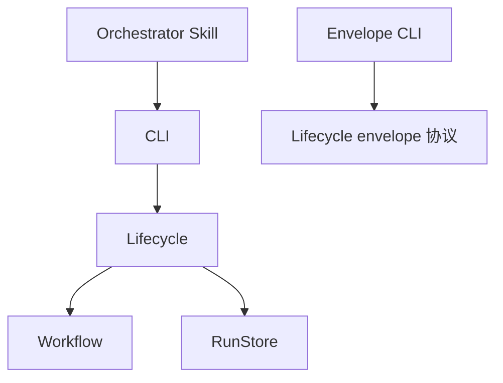
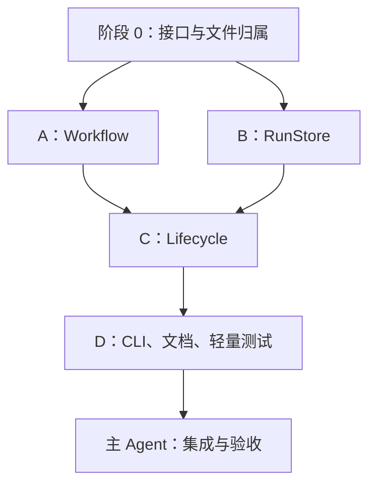

# Orchestrator 模块与接口重构方案

日期：2026-11-11  
状态：设计方案，尚未实施  
目标代码：`packages/orchestrator/`  
适用分支：`dev`

## 1. 目标与完成标准

本次将现有按操作分散的实现，整理为 **Lifecycle、Workflow、RunStore 三个核心模块，以及 CLI 入口**。保留 Skill 主导决策的运行方式和六个生命周期命令，让业务规则、派发约束、文件提交分别有唯一归属。

完成后，维护者应该能够直接回答：

- 修改交付预算或 Issue 顺序：修改 Workflow。
- 修改派发授权、报告关联或重复操作行为：修改 Lifecycle。
- 修改运行文件布局、提交和恢复机制：修改 RunStore。
- 修改命令参数、输入文件处理或终端输出：修改 CLI。
- 修改专业判断和路由指引：修改 Orchestrator Skill 或其工作流资源。

本文件只规划重构。实施需要后续明确启动，不因方案落盘自动开始。以下 subagent 分工用于未来实施，不表示已经派发。

### 1.1 必须解决的问题

1. 正常 prepare 与恢复分别构造派发信息，容易发生字段和预算不一致。
2. `prepare.ts` 自行构造 envelope，`envelope.ts` 又存在另一套构造函数。
3. 生命周期约束、Issue 交付规则与底层文件操作相互混杂。
4. 请求类型、运行时验证、实际接收字段不一致。
5. 重复 prepare 没有比较全部任务相关字段。
6. 未知 workflow 名称回退为默认流程，而完成规则又依赖名称 `default`。
7. 模块内导出与正式外部接口没有明确区分。

### 1.2 本次不增加的能力

- 不增加 SDK、公共 TypeScript package API、独立产品 CLI。
- 不增加执行引擎、Provider 注册系统、依赖注入容器或插件框架。
- 不增加数据库、事件溯源、通用事务框架、后台服务。
- 不增加并行调度、分布式锁、多写者支持。
- 不让固定脚本代替 Skill 判断下一项专业工作。
- 不改变专业 Skill 的业务职责，不重写 workspace 配置模块。
- 不要求真实 EPIC、真实 Agent、模型 API、GitHub 写入或 SLURM 任务作为验收。
- 不创建新一轮架构研究任务；实现中只调整必要的内部函数和文件布局。

## 2. 设计依据

### 2.1 从 DSH 借鉴什么

参考本地 `deepseek-harness/packages/workflow`：

| DSH 的设计 | 本项目采用的原则 |
|---|---|
| `workflow` 定义服务，调用方不理解执行实现 | CLI 使用完整生命周期操作，不直接协调状态文件 |
| `workflow-ptc` 拥有执行机制 | 底层复杂性由明确模块承担，不散落在调用方 |
| `tool-workflow` 拥有工具输入与展示 | CLI 拥有命令参数和输出媒介，不承载交付规则 |
| 请求、运行句柄、结果有明确语义 | 明确运行身份、派发身份、授权和完成的区别 |

DSH 的实时脚本执行接口不提供本项目所需的持久化恢复，因此不照搬 `start/cancel/dispose` 或 PTC 执行结构。模块职责可以借鉴，具体操作集合由 paper-craft 的 Skill + CLI 用法决定。

### 2.2 采用的 codebase-design 原则

- 隐藏知识，而不只是移动代码。
- 一条重要规则只有一个所有者。
- 调用方不负责协调多个底层步骤才能完成一个操作。
- 不按文件长度机械拆分。
- 不为每个文件建立 class、interface 或 adapter。
- 接口包括输入输出、错误、幂等性和恢复保证，不只是函数名。
- 简单格式化可以局部重复；预算、派发身份、协议验证不能重复实现。

## 3. 当前实现与问题定位

以下路径相对于仓库根目录，描述的是方案编写时的源码状态。

| 当前文件 | 当前职责 | 重构方向 |
|---|---|---|
| `packages/orchestrator/src/cli.ts` | 命令解析、prepare 请求验证、入口分派 | 保留入口路径，收窄为参数和媒介处理 |
| `src/init.ts` | 配置解析、流程初始化、交付序列创建、写状态 | Lifecycle 组织；Workflow 计算交付初态；RunStore 提交 |
| `src/prepare.ts` | 阶段解析、预算、幂等比较、envelope、两次写入 | 分别归 Workflow、Lifecycle、RunStore |
| `src/completion.ts` | handoff、报告解析、校验、状态写入 | Lifecycle 拥有授权与完成；CLI 处理字符串/文件输入 |
| `src/resolve.ts` | 决策记录、序列变化、完成证据检查 | 生命周期状态与 Workflow 规则分开 |
| `src/inspect.ts` | 状态摘要，调用可恢复的 loadState | 保留摘要职责，记录查询可能触发存储恢复 |
| `src/state.ts` | 读取、恢复派发、预算推导、写入 | 存储归 RunStore；移除恢复中的业务推导 |
| `src/workflow.ts` | 定义加载、验证、计划顺序、序列创建 | 发展为拥有交付知识的 Workflow 模块 |
| `src/envelope.ts` | 协议、构造、配置探测、通用写文件 | 构造/协议归 Lifecycle；通用写入归 RunStore |
| `src/types.ts` | 部分协议类型，依赖宽泛 Data | 类型按所有者组织，减少核心状态中的 any |
| `src/envelope-cli.ts` | validate/show | 保留外部入口，复用唯一 envelope 验证实现 |

### 3.1 需要直接纠正的接口问题

- `prepare` 的比较记录遗漏 `scope`、`parameters`、`receipt_template`、`attempt_intent`、`rework_issue` 等影响语义的输入。
- `PrepareOptions` 有 `parameters`，CLI 请求字段白名单却不接受它；需要统一为一个明确协议。
- `loadState()` 在读取时写回恢复结果，并重新推导部分预算；查询副作用和恢复能力没有被准确表达。
- `CompactReport` 与 `CompactExecutionReport` 重复定义。
- `resolveDecision()` 将非预定义 decision 当成阶段名，拼写错误可能变成路由。
- `loadAndValidateWorkflow()` 对未知简单名称使用默认流程并改名；`assertFinish()` 根据 `default` 名称决定是否检查交付关闭和清理证据。

修复这些问题时，区分“保留已有有效能力”和“保留错误行为”。不为旧错误行为建立长期兼容层。

## 4. 目标结构与依赖

### 4.1 逻辑结构



专业 Agent 读取 envelope、写 Markdown receipt、返回 compact report；平台启动 Agent 仍由 Skill 完成，不由以上代码模块执行。

### 4.2 职责与权限

| 模块 | 独占知识 | 可以做什么 | 不负责什么 |
|---|---|---|---|
| Lifecycle | 派发身份、授权、完成、重复请求、协议错误 | 统一组织运行状态变更，调用规则与存储 | 专业判断、Git 操作、预算算法的重复实现 |
| Workflow | 阶段、计划、Issue 顺序、预算、完成证据 | 根据当前输入计算明确的领域结果 | 写文件、生成 dispatch ID、启动 Agent |
| RunStore | 运行文件布局、提交、恢复 | 保存已经确定的状态与 envelope，恢复中断提交 | 判断返工、扣减预算、识别特殊业务阶段 |
| CLI | 参数、输入媒介、输出格式 | 将参数/文件转为输入值，调用 Lifecycle | 直接修改 state.json、实现业务验证 |

“Lifecycle 统一组织变更”不表示所有计算都放进 Lifecycle。Workflow 完整计算预算和序列变化，Lifecycle 应用结果并保存，不在多个入口重复逐字段计算。

### 4.3 建议文件布局

以下是实施起点，允许合并没有独立价值的小文件：

```text
packages/orchestrator/src/
  cli.ts
  envelope-cli.ts
  lifecycle/
    index.ts
    init.ts
    prepare.ts
    completion.ts
    resolve.ts
    inspect.ts
    envelope.ts
    requests.ts
    types.ts
  workflow/
    index.ts
    definition.ts
    delivery.ts
    types.ts
  run-store/
    index.ts
    storage.ts
    types.ts
```

- `index.ts` 可以只集中导出模块入口，不再包一层同名透传函数。
- 模块内部文件不是独立公共模块。
- 保留 `src/cli.ts`、`src/envelope-cli.ts` 的现有调用路径，减少 Skill 和测试命令迁移成本。
- 不建立全局 Contracts、Manager、ServiceFactory 等模块。
- 跨模块只使用模块入口和明确的类型叶文件；不交叉导入内部实现。
- 运行时依赖方向保持单向。类型引用可使用 `import type`，不能借类型文件引入运行时循环。
- RunStore 可引用持久化载荷的类型；它验证存储记录结构，领域字段的完整验证仍由其所有者实现。避免让 RunStore 在恢复时调用 Workflow 的业务计算。

## 5. 外部接口与稳定性范围

### 5.1 正式外部接口

1. 生命周期 CLI 六个操作。
2. Envelope CLI 的 `validate`、`show`。
3. Task Input Envelope JSON。
4. Compact Report JSON。
5. Markdown receipt 的路径、必要内容和引用约定。
6. 默认 `inspect` 状态摘要。

包内 TypeScript export 暂不作为公共 SDK。`state.json` 的完整结构是持久化格式，不作为专业 Skill 的输入协议；Orchestrator 的日常使用通过 CLI 完成。保留诊断字段查询，但不鼓励正常流程依赖任意内部字段。

### 5.2 运行与派发身份

- 运行标识继续使用绝对 `receipt_root`，不新增 Run ID 系统。
- 派发标识继续使用已有 `dispatch_id`。
- `handoff`、`complete` 的 CLI 明确要求 `--dispatch-id`；同步更新所有仓库内调用方和测试。
- compact report 保留四个必填字段，`dispatch_id` 可以继续为可选字段；若报告包含该字段，必须与命令参数一致。
- `complete` 同时验证运行、派发 ID、指定回执路径，不能只依赖“当前活动任务”。

这是一项有意收紧的 CLI 约定，需要在文档和命令示例中同步说明，不保留通过当前任务猜测 ID 的隐藏分支。

### 5.3 六个操作

| 操作 | 输入核心 | 输出核心 | 关键保证 |
|---|---|---|---|
| init | Issue、仓库、配置、流程、receipt_root | 初始化摘要 | 同身份重复调用复用；身份冲突报错 |
| prepare | 运行、阶段、目标、环境、前置回执、覆盖参数 | dispatch ID、step、envelope/receipt 路径、attempt、status | 完整语义一致才复用；不会重复扣预算 |
| handoff | 运行、dispatch ID | authorized、派发摘要 | 同派发仅首次授予启动授权 |
| complete | 运行、dispatch ID、报告 | 完成记录 | 关联检查、回执验证、重复报告处理 |
| resolve | 运行、decision、reason、显式可选参数 | 决策记录和必要摘要 | 验证决定并登记，不自动运行下一阶段 |
| inspect | 运行、可选诊断字段 | 当前状态和阻塞原因 | 不推进业务，可完成确定的存储恢复 |

`init --force` 不扩展成恢复工具。不利用重构自动覆盖用户已有运行；与待提交记录冲突时必须显式拒绝，不能遗留 pending 文件使旧运行复活。

## 6. Lifecycle 详细设计

### 6.1 统一请求定义与验证

- 将 `loadPrepareRequest` 中的业务字段验证移入 Lifecycle 的请求解析函数。
- CLI 负责读取 JSON 文本/文件并完成语法解析；Lifecycle 接收解析后的值并验证结构与含义。
- `complete` 核心入口只接受报告对象，不自行猜测参数是 JSON 文本还是文件路径。
- `resolve` 使用 `continue | wait_user | halt | finish`；阶段通过 `next_stage` 单独传入。
- 拒绝未知 decision 和未知请求字段；错误说明具体字段。
- `parameters` 明确允许 JSON object，拒绝数组或不符合协议的值；工作流默认参数与请求覆盖规则只有一处实现。
- 核心 RuntimeState、Dispatch、Report、Decision 不继续依赖 `Record<string, any>`。业务结果和扩展参数可以使用明确的 JSON object 类型或 `Record<string, unknown>`，在消费时收窄。
- 不对所有历史类型文件做全仓改写，只处理本模块边界实际使用的类型。

### 6.2 prepare 的规范化请求

在重复调用比较之前，生成可持久化的规范化请求。它必须覆盖所有影响任务、归属和预算的请求语义：

| 类别 | 字段 |
|---|---|
| 身份与归属 | 规范阶段 ID、明确的 Issue 归属、rework_issue |
| 执行角色 | provider.type、target、args |
| 任务内容 | objective、scope、acceptance_criteria、合并后的 parameters |
| 输入证据 | 规范化 predecessor_receipts |
| 执行环境 | 绝对 working_directory、branch、commit |
| 回执约定 | receipt_template |
| 预算意图 | attempt_intent，以及 Workflow 解释该意图所需的明确标记 |

派发 step、生成的 dispatch ID 和扣减后的预算不是调用方请求，不应导致相同请求重试变成不同任务。

具体顺序：

1. 校验请求，加载一致的运行状态。
2. 验证 halted、finished、活动派发等生命周期前置条件。
3. 解析稳定的配置快照和阶段默认值，形成规范化任务意图。
4. 如已有 prepared 派发，先比较已保存的规范化意图；相同则返回原结果，不再次消耗预算。
5. 如已有 handed_off 派发，拒绝通过 prepare 再次启动。
6. 无活动派发时，调用 Workflow 计算本次预算和归属变化。
7. 分配 step、dispatch ID 和回执路径；通过唯一构造函数生成 envelope。
8. 验证 envelope，并用一次 RunStore 提交保存 envelope 和完整目标状态。
9. 提交成功后返回派发摘要。

规范化阶段默认值必须来自运行快照，而不是每次读取磁盘上可能变化的配置。比较函数不得调用会再次扣减预算的逻辑。

### 6.3 唯一 envelope 构造路径

- 构造函数消费完整、已解析的数据，不探测 `.paper-craft/workspace-config.json`。
- workspace 配置只在运行初始化等明确入口解析，后续使用快照。
- envelope 七部分结构、字段名称和当前有效协议尽量保持。
- 删除未使用的构造/保存辅助函数，或将真实调用方统一到保留的实现。
- envelope 校验必须符合声明的类型：字符串数组逐项检查，必需对象/字段完整检查。
- 收据模板路径仍正确解析到安装 Skill 的真实 checkout；移动文件后不能破坏相对资源定位。
- `validate/show` 复用这一套协议代码。

### 6.4 handoff 的真实保证

handoff 只记录启动授权，不负责启动平台 Agent：

1. 首次调用将 prepared 转为 handed_off，并持久化授权事实。
2. 持久化成功后返回 `authorized: true`。
3. 同一派发再次调用返回 `authorized: false`，不构成新的启动许可。
4. Skill 仅在本次 `authorized: true` 时启动 Agent。

授权后、平台启动前中断，执行结果可能不确定。inspect 必须说明“已授权、完成结果未知”，不能宣称任务已成功启动，也不能自动重新授权。现阶段不增加 exactly-once 外部执行机制。

### 6.5 complete 与幂等性

- 先验证请求/报告结构和身份，再确认 assigned receipt 路径与实际非空文件。
- 首次登记只接受处于允许完成状态的派发。
- 对已登记派发的重复 complete，先按 dispatch ID 查找，再校验报告路径和内容，不能绕过身份检查。
- 状态和 result 是完成事实；summary 也纳入明确的重复报告比较，避免含义变化被静默忽略。JSON object 键顺序不构成冲突。
- 相同报告返回既有记录，不增加 completed_stages，不改变时间，不重复清算预算。
- 冲突报告使用明确错误，并按已有协议错误处理要求保存诊断信息。
- 验证失败可以提交 protocol_error；原活动派发保留，不伪造业务完成。
- `execution_status: succeeded` 仍可伴随 `rework_needed` 或 `out_of_scope`。脚本登记事实，Skill 决定后续专业动作。
- 不在本次增加 Markdown 内容语义解析或自动评审器。

### 6.6 resolve 与 inspect

- resolve 拒绝 decision 拼写错误和互相矛盾的参数组合，例如 `finish` 同时指定下一阶段。
- 对当前已经完成的运行，禁止普通 prepare/handoff 再次进入新业务；需要新运行时使用明确的新运行目录。
- wait_user 是等待明确用户决定的状态，不能由 prepare 隐式绕过；continue 明确恢复。
- 不把 resolve 解释为取消已授权的 Agent。不能仅改变阶段就删除仍在执行的派发。
- 已有活动派发时，允许记录 halt/wait 等控制决定，但禁止静默更换其归属、计划或跳过完成；以现有实际用法整理少量明确限制。
- inspect 默认输出稳定摘要，不输出整份 workflow_snapshot 或所有历史回执内容。
- `--field` 保留诊断用途，字段不存在明确报错。
- inspect 调用 loadRun 时允许恢复存储提交；这不会自动运行任务、改变专业结论或消费新预算。

## 7. Workflow 详细设计

### 7.1 一个模块拥有完整交付规则

统一迁入：

- workflow 文件解析、定义验证、阶段查找、已有 logical_task 别名解析。
- 计划任务顺序与依赖检查。
- 子 Issue 交付序列初始化与更新。
- 当前 Issue、返工归属、交付预算、按 originating stage 计算的重规划预算。
- 辅助阶段是否消耗交付次数。
- Issue 完成与资源清理证据的确定性检查。

内部可分为 definition 和 delivery 文件。暂不独立出预算服务、计划服务、完成策略注册表。

### 7.2 返回明确的领域数据

内部接口名称由实现确定，至少表达：

| 能力 | 输入 | 输出 |
|---|---|---|
| 加载流程 | 配置中的路径/名称、资源位置 | 验证后的定义 |
| 解析任务意图 | 定义、请求、当前交付状态 | 规范阶段、provider、默认任务参数 |
| 计算交付变化 | 当前交付状态、任务意图 | Issue 归属、attempt、完整的新预算/序列相关数据 |
| 应用交付决定 | 当前交付状态、显式决定 | 明确的交付领域结果 |
| 检查完成 | 定义、相关完成证据 | 通过或具体失败原因 |

不得返回任意路径形式的 JSON Patch 或任意完整运行状态补丁。Workflow 的结果不包含 active_dispatch、文件提交记录、protocol_error 等其他模块拥有的数据。

### 7.3 流程名、阶段与自定义任务

- `default` 解析到已知资源；其他名称必须解析到真实存在的流程文件，否则报错。
- 删除“未知简单名称套用默认流程并改名”的回退。
- 保留明确路径加载自定义 JSON workflow 的能力。
- 保留已有有效的临时任务用法：未知阶段只有在请求明确提供完整 provider 时，才被视为显式临时任务；仅有阶段名则报错。
- 对已知 logical_task 别名统一解析到 canonical stage ID，避免同阶段因别名消耗不同预算或比较不相等。
- resolve 的 next_stage 必须能解析为已知阶段；临时任务通过显式 prepare 请求表达，不把任意 decision 字符串当成阶段。
- 不增加通用 DSL 或自动路由执行器。

### 7.4 完成条件必须明确选择

完成检查不能依赖显示名称字符串。建议为 workflow 定义提供一个简单、固定枚举字段：

```json
{
  "completion_policy": "issue_delivery"
}
```

- 默认流程显式使用 `issue_delivery`，执行现有 Issue-tree closure、cleanup 和资源核对要求。
- 自定义流程可以明确选择 `issue_delivery` 或 `basic`。
- `basic` 也需要满足通用生命周期条件：没有活动派发、没有未解决协议错误、没有明确未处理的失败/阻塞/返工结果。
- 对未声明的定义采用安全的明确规则：初始化时报错并指出所需字段，不能偷偷采用 basic。同步更新仓库内自定义流程夹具。
- 这只是两种现有完成语义的显式选择，不引入插件注册和自定义脚本钩子。
- 旧的运行快照迁移见第 10 节；不得因为缺少新字段而降低原有完成要求。

`assertCanFinish` 检查已有专业证据，不调用 GitHub、不重新运行专业评审。仍由专业 Agent 产生可信的领域结论，Lifecycle 验证报告关联，Workflow 执行确定条件。

## 8. RunStore 详细设计

### 8.1 最小模块接口

内部可采用以下语义，具体类型名允许调整：

```ts
loadRun(root): RunState
commitRun(root, change): void
```

- `loadRun` 内部完成可确定的恢复，再返回一致状态；调用方不必手动排列 recover/read。
- `commitRun` 接收已经计算好的前置状态、目标状态，以及本次可选新增 envelope。
- 通过明确的“初次创建”输入表达 init，避免调用方自行判断文件是否存在再绕过存储模块。
- state-only 更新也走相同存储入口，不允许 handoff、complete、resolve 各自调用 fs.writeFile。
- 不要求所有 fs 读取都经过 RunStore：读取专业 receipt 或 workflow 资源属于相关模块自己的边界。RunStore 拥有的是运行状态提交和运行内部文件布局。

### 8.2 建议的最小提交记录

单文件原子替换不足以同时保证 envelope 与 state 的恢复一致性。建议在 receipt_root 内使用一个短期 `pending-commit.json`，只记录当前未完成提交：

- 存储记录版本。
- 期望前置状态，初次创建时为 null。
- 完整目标状态。
- 可选新增 envelope 的受约束文件名与完整内容。

它是当前提交的恢复材料，提交结束后删除；不保留历史日志，不成为事件源。可以通过等价的更小实现完成相同保证，但不能退回从 envelope 重新推导业务预算。

存储层需要验证目标文件位于当前运行目录且属于允许的文件类型，不能执行记录中任意绝对路径写入。

### 8.3 提交流程

1. 验证磁盘状态与本次期望前置状态一致，且没有未处理冲突。
2. 原子写入 pending 记录。
3. 若提交包含 envelope：不存在则写入；存在且内容一致则复用；内容不同则停止，不覆盖。
4. 原子写入完整目标 state。
5. 删除 pending 记录。
6. 成功返回。

临时文件写入使用现有 fsync + rename 思路。承诺覆盖进程中断和重试，不宣称已解决所有文件系统、断电或硬件故障；如需宣称更强持久性，必须另行处理目录同步等条件，本次不扩大范围。

### 8.4 恢复流程

| 磁盘状态 | 处理 |
|---|---|
| 没有 pending，state 有效 | 正常加载 |
| 有 pending，state 等于前置状态或初始化时不存在 | 校验并补齐 envelope，写目标 state，清理 pending |
| 有 pending，state 等于目标状态 | 校验/补齐预期 envelope，清理 pending |
| 有 pending，state 既不是前置也不是目标状态 | 报 STORAGE_INCONSISTENT，不覆盖 |
| envelope 已存在但内容不同 | 报冲突，不覆盖 |
| pending JSON 损坏或缺字段 | 报错并保留现场 |

重复恢复不会再次消耗预算，因为写入的是完整目标状态。恢复不调用 Workflow 的预算函数，不重新生成 dispatch ID。

### 8.5 单写者与恢复权限

- 一个 receipt_root 同时由一个 Orchestrator 修改。
- 不增加锁服务或分布式并发控制。
- 前置状态检查可以发现部分陈旧提交，但不把它宣传为完整并发安全。
- 专业 Agent 只写被分配的 receipt，不写 state、envelope 或 pending。
- 发生无法确定的存储冲突时，停止依赖操作并展示路径与原因，不清理证据或自动重新执行任务。

## 9. 错误与输出约定

采用少量稳定错误码，具体命名可在阶段 0 确定：

| 类别 | 示例 |
|---|---|
| 输入问题 | INVALID_REQUEST、UNKNOWN_WORKFLOW、UNKNOWN_STAGE |
| 生命周期冲突 | DISPATCH_CONFLICT、INVALID_TRANSITION |
| 领域约束 | BUDGET_EXHAUSTED、FINISH_REQUIREMENTS_UNMET |
| 报告问题 | REPORT_INVALID、RECEIPT_MISMATCH、REPORT_CONFLICT |
| 存储问题 | STORAGE_INCONSISTENT、STORAGE_IO_ERROR |

- 可以用一个简单的带 code/details 的 Error 类型，不建立错误继承树。
- stdout 只输出成功结果；失败设置非零退出码，并向 stderr 输出简洁结构化错误。
- 具体错误分类保留有意义的区别，文件缺失、损坏和业务约束不能都变成“未知错误”。
- 已授权的 handoff 重试不是异常：返回 authorized=false。
- 相同 complete 重试不是异常：返回已有结果。
- 不静默忽略恢复异常，不用 warning 后继续执行掩盖状态不可信。

## 10. 兼容范围与迁移

### 10.1 保持的能力

- 六个命令名称与两个 CLI 文件路径。
- JSON 配置和任务输入、Markdown receipts。
- 工作目录绑定、绝对 receipt_root、产物位于 disposable checkout 之外。
- 单派发、预算限制、阶段显式决策、双通道报告。
- 有效流程中的专业结果和原有严格完成要求。
- init、prepare、handoff、complete 已有的合理重复调用行为。

### 10.2 有意调整的行为

| 原行为 | 新行为 | 需要同步的地方 |
|---|---|---|
| handoff/complete 可省略 dispatch ID | 明确传入 ID | Skill、示例、测试 |
| decision 可直接写阶段名 | decision 枚举 + next_stage | Skill、工作流说明、测试 |
| 未知 workflow 名套用默认流程 | 报错 | 对应测试与错误说明 |
| 按名称 default 决定完成门槛 | 显式 completion_policy | 默认定义、自定义夹具、快照迁移 |
| scope 等变化可能复用旧 prepare | 完整语义冲突时拒绝 | prepare 回归测试 |
| CLI 不接受 parameters | 与核心请求统一接受并验证 | 请求文档、测试 |
| 恢复异常仅 warning | 明确失败并保留现场 | 恢复测试、故障说明 |

### 10.3 旧运行数据

不能通过清空 receipt_root 来完成重构。

- 对完整、有效的旧 state/envelope/receipt 保留读取和继续运行能力。
- 对旧 default 快照可明确补充 issue_delivery 完成策略；不因字段缺失跳过已有门槛。
- 对自定义旧快照缺少完成策略，返回具体迁移说明，要求明确选择；不能仅依据名称自动降级为 basic。
- 对旧 prepared 派发缺少规范化请求字段，可从已有不可变 envelope 及完整快照读取可确定字段；不可确定的预算意图不能猜。允许显式报冲突/迁移需求，保留原文件。
- 对“旧 envelope 已写、旧 state 未写、没有新 pending 记录”的中断现场，无法恢复完整的交付预算变化时明确停止。新版本的恢复保证针对新提交记录，不承诺凭缺失信息准确重建旧事务。
- 如果新增持久化必填字段需要版本调整，使用一次明确的版本升级和局部转换，不建立长期多代兼容框架。
- 旧文件的读取适配是本次有实际需要的迁移工作；旧源码路径的转发兼容层不需要保留。

## 11. 分阶段实施与 subagent 分工

### 11.1 协作原则

推荐主 Agent 负责接口和集成，使用四个实现 subagent。不是一次性全部启动：只有 Workflow 与 RunStore 在接口明确后适合并行。

- 每个文件在同一时段只有一个编辑者。
- 所有 Agent 基于同一个 dev 工作区协作时，禁止相互 reset、stash 或覆盖未提交改动。
- 子 Agent 只提交自己的产物与说明，不擅自 merge、push 或改 main。
- 需要调整他人接口时先发送变更请求，由主 Agent 协调。
- 不要求每个 Agent 运行完整测试；各自做最便宜的局部检查，最终统一验收一次。
- 每次交接用简短说明：变更文件、接口、验证命令、剩余问题。

### 11.2 阶段 0：主 Agent 冻结最小接口约定

**目标**：避免各 subagent 独立设计出互不兼容的类型。

任务：

1. 检查当前工作区与现有改动，保留用户工作。
2. 阅读涉及目录的 AGENTS.md。
3. 确认核心类型归属、模块入口与资源路径解析方式。
4. 明确规范化 prepare 请求字段、complete 重复报告比较、completion_policy。
5. 明确 RunStore 提交载荷和恢复记录，使 Workflow 不依赖存储实现。
6. 分配文件所有权；必要时创建少量类型叶文件，禁止为了类型而复制业务结构。

**输出**：可供 A/B 使用的接口约定和文件清单。无需另外创建长篇 RFC。

### 11.3 Subagent A：Workflow

**开始条件**：阶段 0 完成。可与 B 并行。

**文件所有权**：`packages/orchestrator/src/workflow/**`。旧文件和全局入口由主 Agent/C 在集成时删除或切换，避免并发冲突。

任务：

1. 整理定义加载和校验，删除未知名称回退。
2. 集中阶段/别名解析及明确临时任务规则。
3. 集中交付序列、返工归属、交付预算和重规划预算。
4. 提供纯计算接口，不写文件、不直接改 Lifecycle 的派发字段。
5. 实现明确 completion_policy 和现有完成证据检查。
6. 对外只导出 Lifecycle 实际需要的函数和类型。

交付要求：提供“旧业务规则 → 新函数”的简短映射；列出需要 D 同步的 workflow JSON 和测试夹具变化。

### 11.4 Subagent B：RunStore

**开始条件**：阶段 0 完成。可与 A 并行。

**文件所有权**：`packages/orchestrator/src/run-store/**`。

任务：

1. 集中运行文件布局和原子 JSON 写入。
2. 实现 loadRun/commitRun 及最小 pending 提交记录。
3. 支持 state-only、state + envelope、初始化三种实际提交需求。
4. 检测同名 envelope 冲突、前置状态冲突、损坏恢复记录。
5. 恢复只补齐已确定提交，不重新生成派发和预算。
6. 明确旧中断现场无法完整恢复时的错误。

交付要求：给出提交/恢复分支说明、错误分类及一份可供测试构造的最小 pending 示例。不得增加数据库、锁系统或通用事务 API。

### 11.5 Subagent C：Lifecycle 与协议集成

**开始条件**：A/B 接口可用；与 A/B 对同一共享接口的修改必须串行协调。

**文件所有权**：`packages/orchestrator/src/lifecycle/**`，以及主 Agent 指定的旧实现迁移文件。

任务：

1. 整理六个操作，统一 RuntimeState 和 CompactReport 等类型。
2. 实现唯一 prepare 请求解析和规范化比较。
3. 统一 envelope 构造/验证，移除配置探测和重复构造路径。
4. 调用 Workflow 计算领域结果，调用 RunStore 提交。
5. 明确 handoff 授权语义和 complete 身份/幂等检查。
6. 收紧 resolve 的 decision 和操作状态前置条件。
7. 保留 inspect 摘要能力，清楚表达恢复与不确定授权状态。
8. 将旧运行读取适配限制在必要范围，避免散落 fallback。

交付要求：六个入口可被 CLI 直接调用；无直接 state 写入；没有向 Workflow 回漏预算算法。

### 11.6 Subagent D：CLI、调用方、文档与轻量测试

**开始条件**：C 的六个入口稳定。

**文件所有权**：两个 CLI 入口、相关 Skill/文档/JSON 工作流、`tests/e2e/` 受影响文件。修改 tests 前遵循 `tests/AGENTS.md` 并读取 pc-test-budget；修改 Skill 前遵循 `skills/AGENTS.md` 的写作要求。

任务：

1. CLI 保留参数和媒介处理，改为调用 Lifecycle。
2. 增加明确 dispatch ID，统一 parameters、decision 等输入。
3. envelope CLI 复用唯一协议实现。
4. 更新 `skills/pc-orchestrator/SKILL.md`、相关 references 和命令示例。
5. 默认 workflow 增加明确完成策略；同步自定义测试夹具。
6. 更新 `docs/design/DESIGN.md` 中受影响的架构和操作说明；按现有 i18n 流程同步其受管理的翻译/记录，不顺带重写无关文档。
7. 复用既有测试，添加极少量必要回归；禁止引入真实外部执行。
8. 扫描所有旧调用方，特别是 handoff/complete 省略 ID、decision 使用阶段名的地方。

交付要求：命令示例可以对应实际参数；没有遗留旧入口 import；测试覆盖关键失败模式。

### 11.7 主 Agent：最终集成与一次检查

1. 审阅模块依赖与单一规则归属。
2. 删除已无调用方的旧文件、重复类型、未使用 helper；不留下长期转发兼容层。
3. 运行第 12 节的最小验收。
4. 修复相关失败，只复跑受影响项。
5. 汇总实际完成内容、命令结果、CLI 收紧点和迁移限制。
6. 完成后停止；提交或推送按届时用户明确指令执行。

### 11.8 阶段依赖



主 Agent 不再额外派发多个重叠架构 review Agent。实施中发现具体问题时，直接交由负责模块的 Agent 修复。

## 12. 简单、快速的验收

### 12.1 验收策略

验收只回答四个问题：

1. 类型与模块引用是否一致？
2. 一个本地派发能否正常准备、授权、登记结果？
3. 重复调用和中断恢复会不会重复派发、扣预算或覆盖输入？
4. 关键错误与完成门槛是否仍然生效？

使用临时目录、微型 workflow JSON、几行 Markdown receipt 和手写 compact report。无需真实 GitHub Issue、PR、worktree 或专业 Agent。测试中的 Issue 编号只是数据。

### 12.2 最小必测场景

| 编号 | 场景 | 关键断言 | 建议复用位置 |
|---|---|---|---|
| T1 | init → prepare → handoff → complete → inspect | 分配路径正确，报告登记一次，活动派发清空，未自动路由 | `kernel-receipt-feature.test.ts` |
| T2 | prepare 重复及修改 scope/parameters 等字段 | 完全相同复用 ID/预算；语义变化拒绝复用 | `envelope-feature.test.ts` 或短直接调用测试 |
| T3 | handoff/complete 重复与错误 ID | 仅首次授权；同报告幂等；错误 ID/冲突报告拒绝 | `kernel-receipt-feature.test.ts` |
| T4 | prepare 提交中断恢复 | 从 pending 恢复同一派发和目标预算；重复恢复不变化 | `lifecycle-recovery.test.ts` |
| T5 | 交付预算与重规划预算恢复 | 选一个子 Issue + 一次 replan，恢复后预算完整，无额外扣减 | 与 T4 同文件，直接调用避免启动大量进程 |
| T6 | 未知流程、未知 decision、完成策略 | 拼错明确失败；Issue 完成策略不能因改显示名绕过；合法完成通过 | `workflow-decoupling.test.ts` 中少量相关用例 |

补充存储冲突检查可与 T4 合并：同名 envelope 内容不同或 pending 损坏时，拒绝并保留现场。不要为每个内部 helper 写镜像测试。

### 12.3 运行命令

类型检查运行一次：

```sh
pnpm typecheck
```

CLI 冒烟只选既有测试中的相关用例；内部规则与恢复尽量直接调用模块，避免每条断言启动 tsx 进程。实施 Agent 可以将新增小型回归集中在一个文件，再与恢复测试一起运行，例如：

```sh
pnpm exec vitest run tests/e2e/lifecycle-recovery.test.ts tests/e2e/orchestrator-refactor.test.ts
```

上面的新增文件名是建议，不要求为计划本身创建空测试文件。如果复用既有文件，就使用实际文件和 `-t` 选择相关用例，不机械执行一个不存在的文件。

修改了受 i18n 管理的文档时，运行已有检查：

```sh
pnpm docs:check
```

最后检查补丁格式与改动范围：

```sh
git diff --check
git diff --stat
```

不把全量 `pnpm test`、完整 build、全部 Python 测试、覆盖率门槛或真实 EPIC 作为本次默认验收要求。若项目实际门禁另有明确要求，则遵守该门禁；不要自行扩展验证范围。

### 12.4 时间与失败处理

- 目标是本地几分钟内完成核心验证，具体耗时以实测为准。
- 遵守已有单测试严格小于 120 秒的要求。
- 某用例过慢时减少进程启动和夹具体积，不提高超时来掩盖问题。
- 失败后只复跑相关用例；修复影响了共享状态协议时，再复跑上述小集合。
- 既有测试中若依赖被有意修改的错误行为，更新断言而不是添加兼容分支。
- 所有受影响测试调用方都要同步修改，即使最终只执行选定小集合；最终报告准确列出实际跑过的范围，不宣称全量测试通过。

## 13. 文档与清理清单

实施完成前核对：

- [ ] 根目录本方案与实际范围没有明显冲突。
- [ ] `docs/design/DESIGN.md` 说明三模块职责及 Skill 的决策权。
- [ ] Orchestrator Skill 的六个操作示例包含正确参数。
- [ ] handoff 文案明确区分授权与平台启动。
- [ ] envelope/report 文档指向同一协议，类型与验证相符。
- [ ] 默认与自定义 workflow 的完成策略明确。
- [ ] 状态读取/恢复失败不会仅警告后继续。
- [ ] 旧的直接 state 写入、重复 envelope 构造、重复预算逻辑已移除。
- [ ] 未增加公共 SDK、插件系统、执行引擎或泛化配置框架。
- [ ] 专业 Skill 不因本次重构获得 workflow 路由职责。
- [ ] 旧运行无法自动迁移的具体情形写入简短说明。

## 14. 最终交付报告模板

实施者最终只需报告：

1. **完成内容**：三模块与 CLI 的实际落点，解决了哪些具体重复或耦合。
2. **调用变化**：dispatch ID、decision、completion_policy 等需要使用者注意的明确变化。
3. **验证结果**：实际命令与通过/失败情况，说明未运行全量测试。
4. **迁移限制**：旧运行哪些可继续，哪些必须明确处理，是否存在尚未解决的问题。
5. **Git 状态**：是否仅修改 dev、是否提交；不能把未执行的 commit/push 描述为已完成。

完成标准是现有 Skill + CLI 工作流更容易使用和维护，并具备一致的派发与恢复行为。无需通过增加模块数量、方法数量或复杂验收来证明重构完成。
